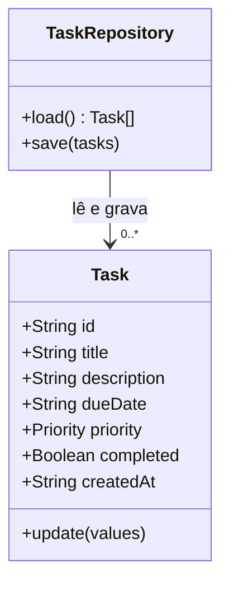

# Organizador de Tarefas Diárias — requisitos e modelagem

**Etapa:** próxima fase após o pré-projeto e o Canvas já enviados  
**Versão:** 0.1 — base para revisão do grupo  
**Plataforma combinada:** aplicação web local, sem conta de usuário

## 1. Problema e objetivo

O grupo identificou que tarefas do dia a dia podem ficar espalhadas em anotações ou na memória. Isso dificulta lembrar prazos e decidir o que fazer primeiro. O objetivo é reunir as tarefas em uma lista simples, com prazo, prioridade e situação.

## 2. Público e limites da versão

- **Usuário:** estudante ou pessoa que deseja organizar atividades pessoais.
- **Uso:** individual, no navegador do dispositivo.
- **Dentro do escopo:** cadastrar, consultar, editar e excluir tarefas; informar prazo e prioridade; concluir e reabrir tarefas; filtrar por situação.
- **Fora do escopo:** login, sincronização em nuvem, tarefas compartilhadas, notificações automáticas, recorrência e integração com outros serviços.
- **Armazenamento:** LocalStorage do navegador. Limpar os dados do navegador pode apagar as tarefas.

## 3. Requisitos funcionais

| Código | Requisito | Critério de aceite |
|---|---|---|
| RF01 | Cadastrar tarefa | A pessoa informa um título; descrição e prazo são opcionais; prioridade pode ser baixa, média ou alta. |
| RF02 | Listar tarefas | A aplicação mostra tarefas salvas, com prioridade, situação e prazo quando informado. |
| RF03 | Editar tarefa | A pessoa altera título, descrição, prazo ou prioridade e salva as mudanças. |
| RF04 | Excluir tarefa | A aplicação pede confirmação antes de remover uma tarefa. |
| RF05 | Concluir ou reabrir tarefa | A pessoa alterna a situação entre pendente e concluída. |
| RF06 | Filtrar tarefas | A lista pode mostrar todas, apenas pendentes ou apenas concluídas. |
| RF07 | Manter os dados no navegador | Depois de atualizar ou reabrir a página no mesmo navegador, as tarefas continuam disponíveis. |
| RF08 | Mostrar resumo | A tela apresenta o total de tarefas, quantas estão pendentes e quantas foram concluídas. |
| RF09 | Validar o título | A aplicação não salva uma tarefa sem título e remove espaços excedentes no início e no fim. |

## 4. Requisitos não funcionais

| Código | Requisito | Verificação |
|---|---|---|
| RNF01 | Usabilidade | A interface e as mensagens devem estar em português claro; ações principais ficam visíveis na tela. |
| RNF02 | Responsividade | Formulário e lista devem continuar utilizáveis em telas estreitas, a partir de 320 px. |
| RNF03 | Acessibilidade básica | Campos têm rótulos, botões podem ser usados pelo teclado e mensagens de estado são anunciadas por leitores de tela. |
| RNF04 | Privacidade | A versão inicial não envia dados a um servidor e não solicita dados pessoais. |
| RNF05 | Segurança de exibição | Texto digitado pelo usuário é exibido como texto, sem ser interpretado como HTML. |
| RNF06 | Compatibilidade | A aplicação deve funcionar nas versões atuais de Chrome, Edge e Firefox com JavaScript habilitado. |
| RNF07 | Confiabilidade | Falhas ao ler ou gravar o armazenamento local devem ser informadas; a interface não deve dizer que salvou quando não salvou. |
| RNF08 | Limite de armazenamento | A aplicação é destinada a listas pessoais pequenas; não oferece backup nem sincronização. |

## 5. Ator e casos de uso

**Ator principal:** Usuário.

1. Cadastrar tarefa.
2. Consultar lista e resumo.
3. Filtrar tarefas por situação.
4. Editar tarefa.
5. Marcar tarefa como concluída ou reabri-la.
6. Excluir tarefa.

## 6. Fluxo principal

```text
Abrir a aplicação
  → informar título, prazo opcional e prioridade
  → salvar a tarefa
  → conferir a lista e o resumo
  → editar, filtrar, concluir/reabrir ou excluir conforme necessário
  → a aplicação grava a alteração no navegador
```

**Fluxo alternativo — título vazio:** a aplicação informa que o título é necessário e mantém o formulário aberto.  
**Fluxo alternativo — falha ao salvar:** a aplicação informa o erro e mantém os dados que ainda estão no formulário.  
**Fluxo alternativo — exclusão:** a aplicação pede confirmação; se a pessoa cancelar, a tarefa permanece.

## 7. Modelo de dados

| Campo | Tipo | Regra |
|---|---|---|
| id | texto | Identificador único da tarefa. |
| title | texto | Obrigatório; até 90 caracteres. |
| description | texto | Opcional; até 280 caracteres. |
| dueDate | data/texto | Opcional; data no formato ISO (AAAA-MM-DD). |
| priority | enumeração | `low`, `medium` ou `high`; inicia em `medium`. |
| completed | booleano | Inicia como `false`. |
| createdAt | data/hora | Preenchido pela aplicação no cadastro. |

Os registros são guardados em uma lista JSON no LocalStorage. Não há banco de dados relacional nesta versão, portanto o DER não se aplica; o modelo acima representa os dados persistidos.

## 8. Diagrama de classes conceitual



## 9. Tecnologias propostas

- HTML semântico para a estrutura.
- CSS para apresentação e adaptação a telas menores.
- JavaScript para os casos de uso e validação.
- LocalStorage para persistência local, sem backend.

Essa escolha atende ao recorte enviado pelo grupo e deixa a demonstração simples. A limitação é que os dados ficam vinculados ao navegador e ao dispositivo usados.

## 10. Casos de teste para a etapa de implementação

1. Cadastrar tarefa com título, prazo e prioridade; conferir que aparece na lista.
2. Tentar cadastrar sem título; conferir a mensagem e a ausência de novo registro.
3. Editar a descrição e prioridade; conferir a atualização após recarregar a página.
4. Marcar e reabrir uma tarefa; conferir a mudança nos filtros e no resumo.
5. Filtrar pendentes e concluídas; conferir que cada lista mostra somente o estado escolhido.
6. Excluir e cancelar a confirmação; conferir que a tarefa cancelada permanece.
7. Excluir e confirmar; conferir que o total diminui.
8. Inserir texto com caracteres como `<script>`; conferir que aparece como texto e não é executado.
9. Usar a tela em largura estreita; conferir que não há rolagem horizontal do conteúdo.
